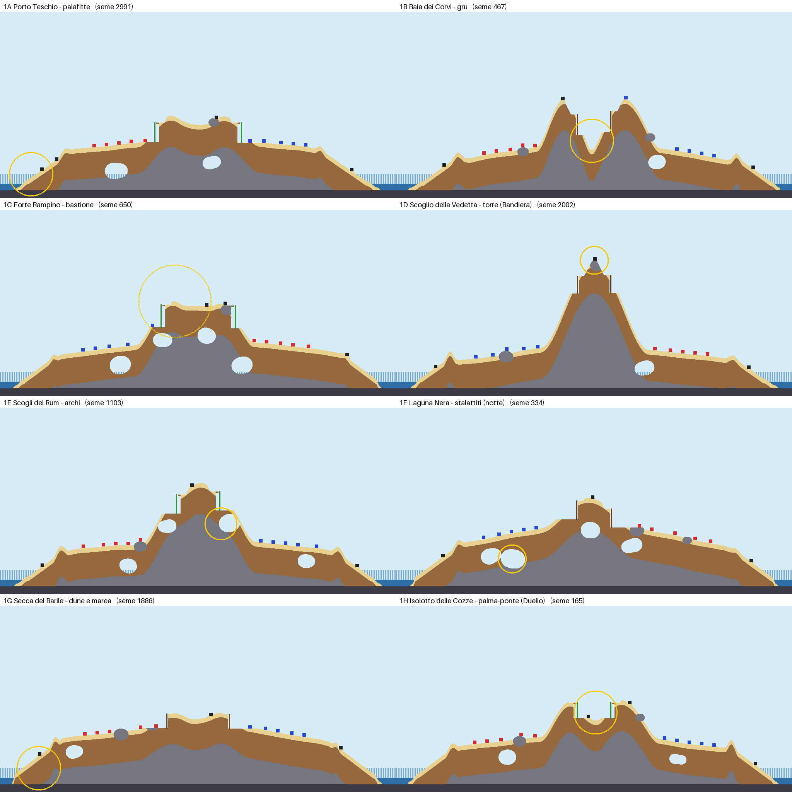

# Le 8 isole di «Acque di Casa»: trucchi ambientali e semi (Scenario e livelli, P2 Fase A)

*Agente Scenario e livelli, 21/11/2026. Ramo `claude/p2-livelli`. Base: PIANO.md §4.4-4.5, livelli.md §3 (dec. 4-10), game-design.md dec. 7-10, progressione.md §3, 06-livelli §4 e §7. Solo Fase A: progetto dei trucchi e semi validati col generatore di oggi. Kit di moduli e isole vere aspettano la Fase 3 di P1 (crolli).*



*Anteprima a metà risoluzione. Rosso = lato 0 (attaccante), blu = lato 1, nero = barili, marrone = scale, verde = liane, cerchio giallo = dove va il trucco. Righe azzurre = mare della Marea alta (y 900).*

## 1. Le regole comuni a tutti i trucchi

1. **Un colpo, tante conseguenze.** Ogni trucco si attiva con un solo colpo ben messo (cannone o granata, oppure sciabola sulle funi) e cambia la forma del campo, non solo i PV. È il rompicapo «dove e quando mirare» che il proprietario vuole tenere.
2. **Si vede prima di tirare.** Ogni pezzo che può cedere ha un segno leggibile: pali con la corda, crepe dipinte, fune tesa. Con l'anteprima delle conseguenze di game-design dec. 10 (tieni premuto sul punto d'impatto) il pezzo che cadrebbe si colora di rosso.
3. **Anti-frustrazione (06 §7 estesa da livelli.md dec. 10).**
   - Nessun pezzo che cede entro 120 px da uno spawn.
   - Nessun crollo nel turno 1: i pezzi sono «bloccati» fino al primo turno del difensore.
   - Danno massimo di un crollo: 12 per le macerie (tempo 1), 20-30 per una massa intera (tempo 2). Mai una morte sicura da PV pieni. I numeri finali li decide Bilanciamento.
   - Un crollo non chiude mai un'area con il ferro e non lascia un pirata senza strada verso il nemico (06 §7.5): il test lo ricontrolla dopo il crollo.
4. **Un trucco per isola, uno alla volta.** Nessun sistema nuovo oltre a quelli di P1 Fase 3 (sostegno strutturale, tempo 1 e tempo 2) e ai materiali di game-design dec. 8 (legno che brucia, sabbia che frana). Le sole due eccezioni sono segnalate: la **caduta a copione** della palma (1H) e la **marea a ciclo** (1G).
5. **Ogni trucco ha il suo test** (Fase B): si spara il colpo che lo attiva, si controlla che cada quello che deve cadere, si conta il danno massimo, e si rilancia il validatore sul campo dopo il crollo.

## 2. Le 8 isole

Ordine consigliato di gioco (progressione.md): round 1 → 1D e 1C; round 2 → 1E; round 3 → 1F e 1G; round 4 → 1H. 1A e 1B sono del giocatore dall'inizio: la loro mappa si vede solo quando la Marina le contrattacca, quindi il loro trucco è pensato **in difesa**.

### 1D Scoglio della Vedetta — torre di vedetta (Bandiera) · seme 2002
- **Forma:** una sola punta alta e stretta (cima a y 321, larga 52 px), due piane basse ai lati. È la vetta più alta tra 3000 semi validi. Due scale portano sull'altopiano sotto la punta.
- **Trucco:** la **bandiera della Marina** sta sulla punta di roccia. Su ogni spalla della punta c'è una **torre di vedetta** di legno a 2 piani (moduli *torre* + *scala* + *anello*): è la via più veloce verso la vetta. Due pali per torre: se ne tagli uno con un colpo la torre crolla **verso il colpo** (tempo 2) e porta giù chi c'è sopra.
- **Perché funziona:** è la prima battaglia. Insegna la scala (tutorial di progressione.md) e dà il primo «wow» di distruzione entro 5 minuti (business). La scelta: salire veloce sulla torre o abbatterla sotto al nemico che sale.
- **Equità:** una torre per lato, stessa altezza. La bandiera resta sulla roccia: il crollo non la sposta mai.
- **Serve:** sostegno strutturale tempo 2 (P1 Fase 3), regola Bandiera (P1 §4 delle richieste di P2-contratti).

### 1C Forte Rampino — bastione di ferro con portone · seme 650
- **Forma:** una collina sola con l'altopiano più largo (370 px), grotte sotto i fianchi.
- **Trucco:** sull'altopiano il **bastione della Marina**: muri di **ferro** alti 64 px (non si scavano) su tre lati, il **portone di legno** sul lato dell'attaccante, il tetto aperto. Si entra in tre modi: sfondare il portone (2 cannonate, o il legno che brucia), **scavalcare** con le liane già sui fianchi, o **far crollare il pavimento** scavando dalle grotte sotto (il ferro regge, la terra sotto no: il bastione si inclina e i difensori scivolano fuori). Due **anelli di ferro** sui muri anticipano il Rampino, che è il premio dell'isola.
- **Anti-frustrazione:** il tetto è aperto, quindi l'area non è mai chiusa dal ferro (06 §7.5). Ferro totale ≈ 2.000 px, sotto il 3%.
- **Serve:** solo materiali che esistono già (ferro, legno) e il tempo 1 per il portone. **È il trucco più facile**: si può costruire per primo in Fase B.

### 1E Scogli del Rum — archi di roccia che crollano (scogliera) · seme 1103
- **Forma:** una collina con grotte dal tetto sottile (≤ 48 px di roccia) sui fianchi: è il seme con più «archi naturali» (20.000 px di grotta sotto un tetto sottile).
- **Trucco:** due **archi di roccia** per lato (modulo *arco*) sopra le grotte: ci si cammina sopra e ci si ripara sotto. Un colpo sul pilastro fa cadere l'arco **intero** (tempo 2, 20-30 danni) e lo trasforma in una rampa di macerie. Così chi è sopra cade e chi era sotto resta schiacciato o trova un nuovo passaggio.
- **Serve:** tempo 2.

### 1F Laguna Nera — stalattiti (grotta, notturna) · seme 334
- **Forma:** la mappa con le grotte più grandi e dal tetto più spesso (30.000 px di grotta, tetto sottile zero).
- **Trucco:** dalle volte delle grotte pendono **stalattiti** di roccia larghe 16-24 px. Un'esplosione entro 40 px le stacca (tempo 1): cadono dritte, fanno 20 danni a chi c'è sotto e restano piantate come **stalagmiti**, cioè un riparo nuovo. Di notte si vedono solo alla luce delle lanterne: chi spara alla lanterna giusta illumina la trappola.
- **Limite di oggi:** il generatore di oggi fa solo il terreno dell'Isola. Una vera Grotta ha il **soffitto** su tutta la mappa (06 §2): va fatta in Fase B, ed è il lavoro più grosso del generatore. Il seme 334 resta valido finché il bioma Grotta non esiste.
- **Serve:** tempo 1, bioma Grotta col soffitto, notte (P1).

### 1G Secca del Barile — dune e marea · seme 1886
- **Forma:** la mappa più piatta (cima a y 613) e una delle poche che **passano tutto il validatore anche con il mare a 900** (Marea alta). Con il mare di oggi (950) gli spawn stanno almeno 162 px sopra l'acqua alta.
- **Trucco:** **marea a ciclo**. Ogni 3 round il mare sale a 910 per un round e poi torna a 950. Un'onda dipinta lo annuncia un turno prima. Le **dune di sabbia** (modulo *rampa* in sabbia) franano sotto i colpi (game-design dec. 8) e i **barili spiaggiati** mezzi sepolti fanno catena. Il rompicapo: colpire i barili quando il nemico è sulla duna bassa e la marea sta per salire.
- **Problema da decidere (Lead P2 e Bilanciamento):** lo scontro chiede `bariliExtra: 5`, ma con 5 posti di spawn per lato **su questa mappa c'è un solo posto libero in più** a ≥ 200 px da tutti gli spawn (provato anche sui semi di riserva 430 e 1432: zero posti). E il validatore accetta solo 3-4 barili (`BIL.barili.max`). Proposta: i 5 barili extra stanno sulle dune e contano la distanza solo dagli spawn **usati** (la Marina ne usa 1), e non si accendono nel turno 1. In alternativa: 2 barili extra invece di 5.
- **Serve:** marea a ciclo nella sim (nuovo, piccolo: un numero di `mare` che cambia a fine round), sabbia che frana (P1).

### 1H Isolotto delle Cozze — palma che fa da ponte (Duello) · seme 165
- **Forma:** due colline con una valle stretta in mezzo (178 px di larghezza, 90 di profondità) e una liana su ogni bordo.
- **Trucco:** su ogni bordo della valle c'è una **palma** alta 220 px. Un colpo alla base la abbatte: cade **dentro la valle** e diventa un **ponte di legno** tra le due colline (20 danni a chi c'è sotto). Nel duello 1 contro 1 con Rigidini il ponte è la strada per arrivare alla sciabola, o una trappola se lo fai cadere sul nemico.
- **Caduta a copione:** la palma non rotola davvero. Si anima una rotazione di 0,6 s e alla fine si stampa nella maschera un tronco di legno spesso 16 px, sempre nella stessa posizione. È deterministico e costa zero alla fisica.
- **Serve:** tempo 1 per la base, la stampa del tronco (piccola, P2).

### 1B Baia dei Corvi — gru con il carico (porto, in difesa) · seme 467
- **Forma:** due colline con la valle più profonda (245 px), a V.
- **Trucco:** una **gru di legno** su una collina con il braccio sopra la valle. Dalla fune pende un **carico** (cassa di palle di cannone, 64×48 legno e ferro). Tagli la fune (con la sciabola o con un colpo entro 12 px) e il carico cade nella V: fa 30 danni a chi c'è sotto e **riempie la valle**, diventando un ponte tra le due colline. La gru stessa è legno: se ne tagli il palo cade (tempo 2).
- **Perché in difesa:** 1B è del giocatore. Quando la Marina la attacca, la gru è dalla parte del giocatore: impara a usarla mentre difende.
- **Serve:** fune tagliabile (game-design dec. 9: sciabola che taglia le funi), tempo 2.

### 1A Porto Teschio — palafitte (porto, firma, in difesa) · seme 2991 provvisorio
- **Forma di oggi:** due colline basse e la riva bassa più lunga tra i semi validi. È **provvisoria**: 1A diventa la mappa fatta a mano «La Bocca del Teschio» (06 §6) in Fase B.
- **Trucco:** **palafitte e pontili** sulla riva, sopra una **secca di sabbia** (non sul mare: chi cade prende le macerie, non annega). Ogni palafitta ha 3-4 pali: tagliarne due la fa cadere (tempo 1, ≤ 12 danni). In più ci sono i 5 barili del paese di Scarlatta (06 §6.1).
- **Serve:** tempo 1. In Fase B la mappa a mano, con lo stesso validatore.

## 3. I semi scelti

Tutti **validi al primo tentativo** (nessun seme+1, nessuna riserva), scelti fra **3000 semi** (2129 validi) con `scripts/mappe/isole/scegli-semi.ts`. Prima si scelgono le isole con la forma più rara.

| Isola | Trucco | Seme | Forma cercata | Semi adatti | Riserve |
|---|---|---|---|---|---|
| 1D | torre | **2002** | una cima, la più alta e stretta | 1495 | 745, 2922, 794 |
| 1H | palmaPonte | **165** | valle larga ~170, profonda ~90 | 450 | 1664, 814, 923 |
| 1B | gru | **467** | valle più profonda | 160 | 778, 65, 1307 |
| 1C | bastione | **650** | altopiano più largo | 1494 | 1398, 1156, 2523 |
| 1E | archi | **1103** | grotte col tetto sottile | 1680 | 626, 2318, 2599 |
| 1F | stalattiti | **334** | grotte grandi col tetto spesso | 1735 | 1420, 188, 1065 |
| 1G | dune | **1886** | piatta, regge il mare a 900 | 2123 | 430, 1432, 2604 |
| 1A | palafitte | **2991** | riva bassa lunga, due colline | 632 | 799, 2940, 2040 |

- I semi sono scritti in `src/contenuti/capitolo-1.ts` (campo `mappa`). Perché in battaglia esca proprio la mappa scelta, la Campagna deve passare `mappa.seme` come `ConfigBattaglia.seme`.
- `tests/mappe/isole-cap1.test.ts` rigenera ogni isola e controlla: primo tentativo, validatore vuoto, forma ancora adatta al trucco, semi tutti diversi, 1G valida fino al mare 900. **Se il generatore cambia, il test cade**: si rilancia lo script e si aggiornano i semi.
- Il bioma non cambia il terreno di oggi (tutti usano l'Isola): i semi restano validi anche con `porto`, `scogliera` e `grotta`. Quando in Fase B arrivano i moduli e il bioma Grotta, i semi vanno riscelti.

## 4. Il kit di 12 moduli: chi usa cosa (per la Fase B)

| Modulo | Isole | Materiali | Regola fisica |
|---|---|---|---|
| torre | 1D | legno | tempo 2 |
| ponte | 1B (dopo il carico), 1H (tronco) | legno | tempo 1 |
| rampa | 1G (dune), 1E (macerie) | sabbia, roccia | frana |
| galleria | 1C (sotto il bastione), 1F | aria nella roccia | — |
| cengia | 1E, 1F | roccia | tempo 1 |
| arco | 1E | roccia | tempo 2 |
| molo | 1A (palafitte), 1B | legno | tempo 1 |
| gru | 1B | legno + fune | fune + tempo 2 |
| muretto | tutte (ripari ogni ~150 px) | legno, roccia | — |
| masso | 1E, 1G | roccia | rotola (tempo 2) |
| pozza | 1A (secca sotto le palafitte), 1G | sabbia bassa | — |
| anello | 1C, 1D | ferro | punto per il rampino |

Più due pezzi che non sono moduli del kit: **stalattite** (1F) e **palma che cade** (1H, a copione).

## 5. Cosa ho notato e chi lo deve sapere

1. **Le 8 mappe di oggi si somigliano.** Il generatore fa sempre lo stesso profilo (piane, 1-2 colline al centro, 2 appigli, 3 barili). Varietà vera arriverà solo dai moduli e dai biomi in Fase B. Per la Fase A è accettabile (Lead P2).
2. **Marea alta (06 §7.6) quasi impossibile oggi.** Sui 138 semi validi tra i primi 200, nessuno passa il validatore intero con il mare a 900 (solido sotto il 20%, barili troppo vicini al mare, cannone che butta in mare). 1G è stata scelta apposta tra quelli che la reggono (Lead P2, QA).
3. **`bariliExtra: 5` di 1G non ci sta** con le regole di oggi (§2, 1G). Serve una decisione prima che la Campagna lo costruisca (Lead P2, Campagna, Bilanciamento).
4. **Il generatore mette sempre 2 appigli**, anche se le regole ne permettono 4. Per il Bandiera di 1D servono più strade: in Fase B le torri le aggiungono (P1 Livelli / Generatore).
5. **1F ha bisogno del bioma Grotta col soffitto**, che non esiste: è il pezzo più grosso della Fase B (Lead P2).

## 6. Come rifare la scelta

```
npx tsx scripts/mappe/isole/scegli-semi.ts 3000 <cartella>   # ~80 s, stampa la tabella e scrive le anteprime
npx vitest run tests/mappe/isole-cap1.test.ts
```

I profili di ogni isola (cosa cerca nella forma) sono in `scripts/mappe/isole/profili.ts`, le misure in `misure.ts`.
